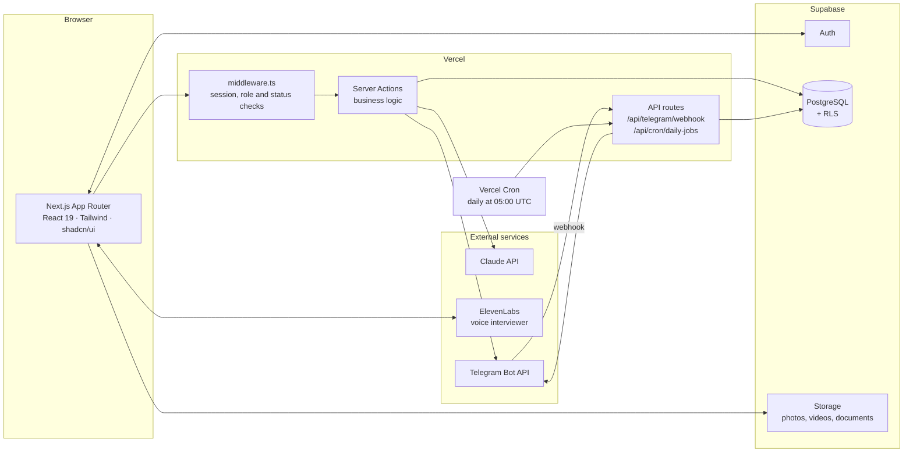
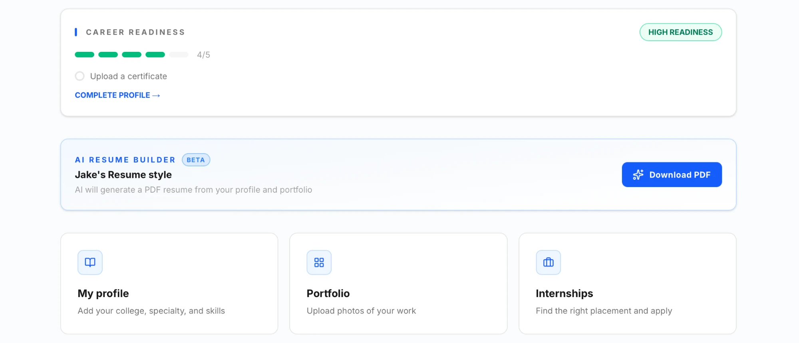
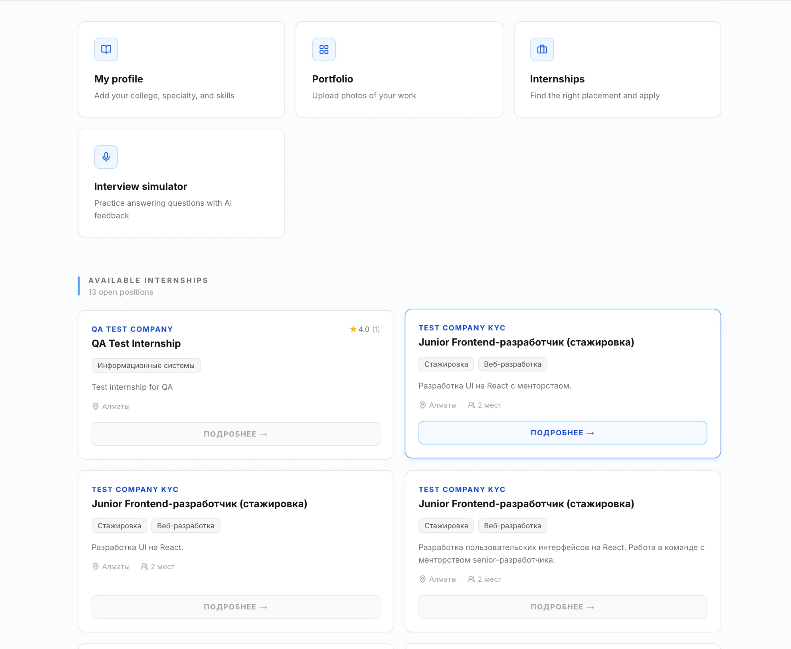
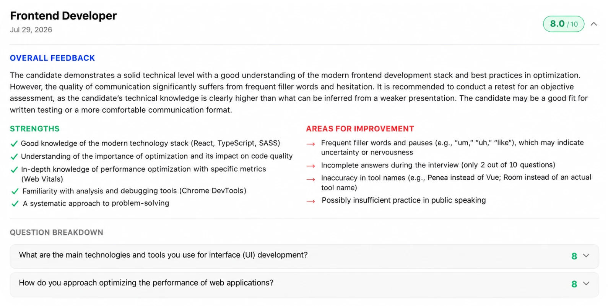
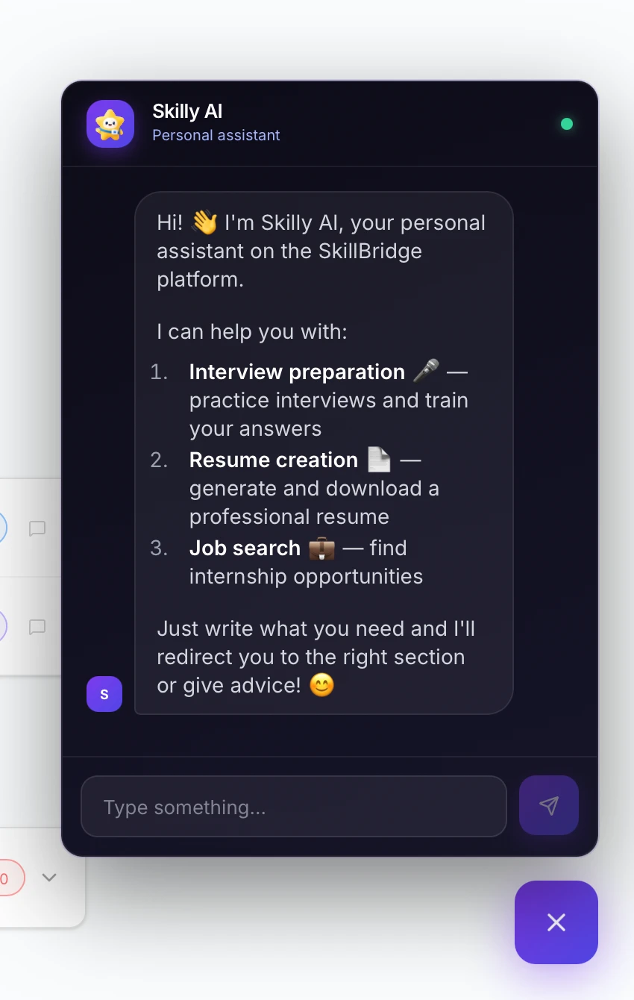

# SkillBridge KZ

**A social-tech platform that helps young people aged 16–24 in Kazakhstan, especially college students and youth from smaller towns, find safe internships, practice placements and first jobs.**

**Live demo:** https://skillbridge-black-delta.vercel.app 
**site:** https://skillbridge-kz-demo.vercel.app/


---

## 1. About the project

SkillBridge KZ brings together **students, employers and colleges**:

- **Students** create a profile, get verified, build a portfolio and receive relevant vacancies. They apply for an internship with one click.
- **Employers** publish internships, search for candidates and chat with them.
- **Colleges** oversee the practice and employment process: they confirm their students, verify academic performance and attendance, and see application statistics.

**The main focus of the project is the safety and accessibility of a first career experience.** This is achieved through employer verification, student verification and a rating system.

**AI tools:** smart vacancy matching, CV assistance, skill-development recommendations and an interview simulator in Kazakh, Russian and English.

### Pilot results

| Metric | Value |
|---|---|
| Students onboarded (two polytechnic colleges, Apr–May 2026) | 100+ |
| Students who secured internships | 12+ |
| Employers who joined | 11+ |
| Interviews conducted | 22 |

**Recognition:** finalist of Tech for Impact; presented at UNICEF Almaty Youth Forum 2026.

### The problem

College students (welders, cooks, auto mechanics, electricians, IT technicians and others), especially those from smaller towns, often struggle to find a place for practice. They have no CV, no portfolio and no experience talking to employers. Employers, in turn, cannot see what a student is capable of or be sure the candidate is real. Colleges do not track where their students end up or how the practice goes. And young people risk running into unreliable employers.

---

## 2. Roles and features

| Role | What they can do |
|---|---|
| **Student** | profile (college, specialty, year, skills, GitHub / LinkedIn / Behance / Figma links) · portfolio with photos and videos · certificates · profile readiness indicator · list of internships · one-click application and status tracking · chat per application · AI-generated CV as PDF · interview simulator · skill-gap analysis · review of the employer |
| **Employer** | company profile and documents · creating internships (format, city, requirements, number of places, deadline) · student search filtered by specialty · portfolio viewing · saving candidates · changing application status · direct messages · review of the student |
| **College administrator** | approving or rejecting registrations · uploading the official student roster (CSV) · verifying GPA and attendance (the "student passport") · viewing applications and marking practice as completed · teacher feedback · summary statistics |

### How registration works

1. A user signs up and chooses a role.
2. The account gets the status **pending**. A student uploads a photo, an employer uploads company documents.
3. A college administrator **approves** or **rejects** the account. Dashboards stay closed until approval.
4. After approval, the user lands in the dashboard for their role.

This keeps random and fake accounts off the platform.

---

## 3. AI-powered features

| Feature | What it does | Technology |
|---|---|---|
| **Skilly AI assistant** | Answers the student in their language (Kazakh / Russian / English) and takes them to the right section: interview practice, CV or vacancies | Claude (Haiku 4.5), tool use |
| **Interview simulator** | A voice interview with an AI interviewer. Afterwards the student gets a report: every answer scored 1–10, strengths, areas to improve, confidence, completeness of answers and recommendations | ElevenLabs Conversational AI and Claude |
| **AI CV builder** | Builds a CV from the profile, portfolio, certificates and practice history, without inventing experience. Exports to PDF | Claude, jsPDF / html2pdf |
| **Skill-gap analysis** | Compares the student's skills with the requirements of a vacancy and shows what is missing | Claude |
| **Vacancy matching** | A daily selection of vacancies matched to the student's specialty (see "Telegram notifications"), plus jumping to vacancies on request in Skilly | Specialty-based matching, Telegram Bot API |
| **Student roster import** | Recognises the columns in any CSV (full name, ID number, specialty, group): first by a dictionary, and by AI if that fails | PapaParse and Claude |

Every AI request first checks that the user is signed in, so outsiders cannot burn the API quota. A profanity filter is applied to user messages.

---

## 4. Architecture



**Key design decisions:**

- **Next.js App Router with Server Actions.** All business logic and all calls to the database and to AI run on the server, so API keys never reach the browser.
- **Layered security.** Middleware checks the session, the approval status and the role, so each role can only open its own section. Server Actions re-check permissions, for example `assertAdmin()` for administrator actions. The project rules require Row Level Security to be enabled on every Supabase table.
- **The Supabase service key** is used only on the server, for actions that need elevated rights (approving users, notifications, the cron job).
- **The cron endpoint** is protected by a secret (`Authorization: Bearer CRON_SECRET`).
- **Three interface languages:** Kazakh, Russian and English (dictionaries in `src/dictionaries`).

### Telegram notifications

- A user clicks "Connect Telegram", and the bot links the chat to their profile through a webhook.
- An employer is notified about a new application. A student is notified when the status of their application changes.
- Once a day (05:00 UTC) a student receives up to 5 new vacancies that match their specialty and that they have not applied to yet.

---

## 5. Data model (Supabase / PostgreSQL)

| Table | Purpose |
|---|---|
| `profiles` | Core user profile: role, name, city, phone, photo, approval status, Telegram link |
| `students` | Student data: college, specialty, year, skills, GPA (and its verification), attendance, links |
| `employers` | Company: name, description, contacts, documents |
| `college_admins` | College administrators and their college |
| `internships` | Internships: title, specialty, city, format, requirements, number of places, deadline, status |
| `applications` | Student applications, their status, teacher feedback |
| `portfolio_items` | A student's work (photos, videos) |
| `student_certificates` | Certificates |
| `messages`, `direct_threads`, `direct_messages` | Chat per application and direct conversations |
| `interview_simulations` | Results of the interview simulator |
| `ai_skill_gaps` | Results of the skill-gap analysis |
| `courses` | Recommended courses per specialty |
| `employer_reviews` | Reviews of employers and students |
| `saved_students` | Candidates saved by an employer |
| `official_college_roster` | The college's official student list used for verification |

TypeScript types are generated from the database schema (`src/types/supabase.ts`).

---

## 6. Tech stack

| Layer | Technologies |
|---|---|
| Frontend | Next.js 16 (App Router), React 19, TypeScript, Tailwind CSS v4, shadcn/ui, Radix UI, Rive (animated Skilly mascot) |
| Forms and data | React Hook Form, Zod, TanStack Query |
| Backend / database | Supabase: Auth, PostgreSQL (RLS), Storage; Server Actions |
| AI | Claude API (`@anthropic-ai/sdk`), ElevenLabs Conversational AI |
| Notifications | Telegram Bot API |
| Documents | jsPDF, html2pdf.js, html-to-image, PapaParse |
| Deployment | Vercel (including Cron) |

---

## 7. Project structure

```
src/
├── app/
│   ├── page.tsx              # landing page
│   ├── auth/                 # sign-up and sign-in
│   ├── pending/              # waiting for approval (photo / documents)
│   ├── student/              # student dashboard: profile, internships, applications, interview simulator
│   ├── employer/             # employer dashboard: internships, applications, student search
│   ├── admin/                # college dashboard: approvals, student roster, statistics
│   ├── actions/              # Server Actions: Skilly AI, notifications
│   └── api/
│       ├── telegram/webhook/ # Telegram linking
│       └── cron/daily-jobs/  # daily vacancy digest
├── components/               # UI components, chats, Skilly widget
├── contexts/                 # language switching
├── dictionaries/             # ru.json · kz.json · en.json
├── lib/                      # Supabase clients, Telegram, profile readiness, profanity filter
├── types/                    # database types
└── middleware.ts             # authentication and role-based access control
```

---

## 8. Running locally

```bash
git clone https://github.com/MoldashDariya/skillbridge.git
cd skillbridge
npm install
# create a .env.local file and fill in the variables listed below
npm run dev
```

The app opens at http://localhost:3000.

Environment variables (`.env.local`):

```
NEXT_PUBLIC_SUPABASE_URL=
NEXT_PUBLIC_SUPABASE_ANON_KEY=
SUPABASE_SERVICE_ROLE_KEY=
ANTHROPIC_API_KEY=
ELEVENLABS_API_KEY=
NEXT_PUBLIC_ELEVENLABS_AGENT_ID=
TELEGRAM_BOT_TOKEN=
NEXT_PUBLIC_TELEGRAM_BOT_NAME=
NEXT_PUBLIC_SITE_URL=
CRON_SECRET=
```

`.env*` files are excluded from the repository (`.gitignore`).

---

## 9. Screenshots

**Student dashboard:** career readiness, AI resume builder and quick access to profile, portfolio, internships and the interview simulator.



**Available internships** from verified employers.



**AI interview simulator feedback:** overall score, strengths, areas for improvement and a per-question breakdown.



**Skilly AI**, the personal assistant that helps with interview preparation, resume creation and job search.



---

## 10. Author

Dariya, author and developer of the project.
GitHub: [MoldashDariya](https://github.com/MoldashDariya)

## Team

- Dariya Moldash: founder, lead engineer
- Adeliya Abytalim: design
- Zhaniya Koshkimbayeva: business development, college partnerships
- Amir Anuar: project coordination, user feedback
- Rahymzhan Moldash: database migrations, Supabase
